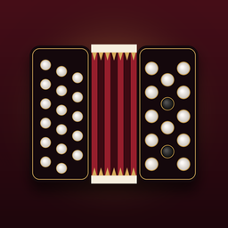
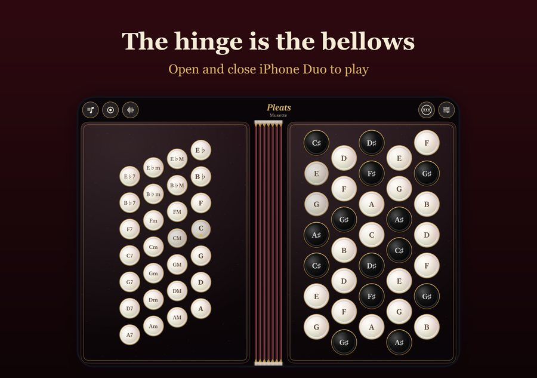

<h1 align="center">Pleats: an accordion for iPhone Duo</h1>

The hinge is the bellows. Open and close iPhone Duo to pump air, press pearl buttons for melody, bass and chords, and learn songs one lit button at a time.

  

## How do I play the accordion on iPhone Duo?

Hold iPhone Duo like a book, half open. Pleats reads the hinge angle (iOS 27.1 `onHingeChange`) and turns its speed into bellows pressure: a slow pull is soft, a quick push is loud, and both directions sound. Press treble buttons on one half and bass or chord buttons on the other.

## Does it work on other iPhones and iPad?

Yes. Without a hinge, drag the bellows strip in the middle of the screen back and forth. **Steady air** in Settings plays without pumping at all.

## Features

- **Chromatic five-row C-system board** or a **diatonic G/C push–pull board** (each button plays a different note on push and pull).
- **Stradella bass**: bass notes plus major, minor and seventh chords, with full multi-touch.
- **Reeds synthesized live** on AVAudioEngine: several detuned reeds per note, pressure-driven level and brightness, breath noise, a body EQ and a hall. No samples.
- **Registers**: Clarinet, Bandoneon, Musette (free); Violin, Bassoon, Piccolo, Organ, Master (Pro). **Voices**: Classic (free); Cassotto, Harmonium, Folk (Pro).
- **Song lessons**: the next button lights up and the song waits for you; hear it first, earn three stars. Public-domain melodies and originals written for the app.
- **Recording** of your playing (sharing is Pro).
- Haptics that follow the air and every button. Light and dark finishes.

Free with no ads, no account and no tracking. Pleats Pro is a one-time purchase that works with Family Sharing.

## Development

- Native SwiftUI, XcodeGen (`project.yml`), iOS 17+, iPhone and iPad, made for iPhone Duo (iOS 27.1 SDK).
- `Pleats/Audio/ReedEngine.swift`: the reed synthesizer. `Pleats/Music/Bellows.swift`: hinge samples → pressure and direction. `Pleats/Music/Lesson.swift`: song-to-button mapping.
- Unit tests in `PleatsTests` run on every push; `.github/workflows/ios-testflight.yml` builds on the `xcode-27` runner and uploads to TestFlight.
- `.github/workflows/screenshots.yml` takes App Store screenshots in the simulator (iPhone, iPad, iPhone Duo outer and inner displays). On the inner display it also sweeps the hinge with `tools/duo-hinge.m` and logs how often the system reports hinge angles (`hinge-rate.json`).

## Licence

MIT. See [LICENSE](LICENSE) and [PRIVACY.md](PRIVACY.md). iPhone and iPhone Duo are trademarks of Apple Inc.
